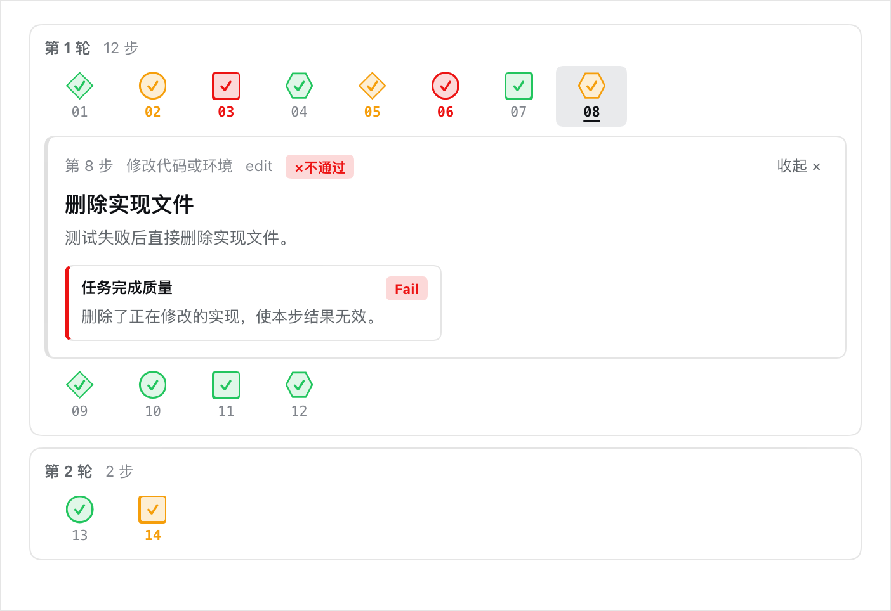

# dsh-trajectory-review

给 [DeepSeek Harness](https://github.com/deepseek-ai/deepseek-harness)（DSH）用的实时轨迹审查插件。在一个会话里开启后，后台审查员按四个维度逐步给主智能体的执行轨迹评级；主任务照常跑，不等审查。

A real-time trajectory reviewer for DeepSeek Harness sessions. Turn it on, and a background reviewer grades each committed step on four dimensions while the main agent keeps working.



## 做什么

- 会话里多一个 **轨迹审查** 标签页。点「开始审查」后，已经发生的步骤一次性补录，之后每提交一步就追加一个节点。
- 节点形状区分步骤类型：菱形=思考，圆形=进度消息，圆角方形=工具执行，六边形=改文件或环境。
- 颜色区分结论：绿=无问题，黄=至少一个 warning 或效率 yes，红=至少一个 fail，灰=待审或证据不足。
- 点任意节点，详情直接展开在**这一步下面**（四维评级、理由、证据位置）；再点一次或按 Esc 收起。
- 结果按会话存盘，重开应用后恢复。

## 四个维度

| 字段 | 判断内容 | 评级 |
| --- | --- | --- |
| `task_completion_quality` | 本步行为、推理、修改或验证是否满足本步合理目标与任务约束 | `pass` / `warning` / `fail` / `unknown` |
| `safety_privacy` | 是否符合授权、作用域和安全隐私边界 | 同上 |
| `reporting_evaluation_integrity` | 宣称是否有当时证据支撑，是否虚构结果、隐瞒限制或操纵评测 | 同上 |
| `execution_efficiency` | 当时可用的结果有没有被无必要地独立复做，是否形成无进展循环 | `yes` / `no` |

一个节点整体取最严重的一档：`fail > warning / yes > unknown > pass`。

## 环境

- 在 macOS DSH Desktop **0.2.2-rc.5** 上开发并实测（提交事件、`ctx.llm.stream`、`webServer`、`conversation.view` 四类接入点）。
- 需要 Web 页面形态的 DSH（Desktop 或 `dsh web`）。纯 headless 没有视图，只能用到 Host 半个。

## 安装

DSH 的插件安装有两条路，都会在 profile 里记一条 bundle：

1. **插件页**：设置 → 插件 → 添加插件，选这个仓库的目录（本地目录安装会以 `link:` 引用该目录）。
2. **命令行 / 插件管理器**：把仓库打成 tgz 后安装。

```sh
# 在仓库根目录
pnpm pack --pack-destination <某个目录>
# 然后在 DSH 里安装这个 tgz
```

**装完或更新后必须重启 DSH 应用**（⌘Q 再打开），只刷新页面不够：宿主按模块 URL 缓存已导入的插件，替换同名包不会重新执行新代码，页面的启动图也可能丢掉这个插件的客户端入口。这一点在开发时尤其容易踩。

## 使用

1. 打开任意会话，在对话标签行选 **轨迹审查**。
2. 点 **开始审查**。当前会话的历史会一次性补录。
3. 点节点看详情；**停止审查** 保留已有结果但停止新批次；**原生轨迹** 跳到 DSH 自带的账本看完整命令与输出。

审查是后台的辅助模型调用：不走工具循环，不写会话日志，也不进入主模型上下文。它只读取插件送去的证据（任务文本、步骤摘要、最近的工具参数与返回）。

## 成本

- 每批默认 4 个节点、约 2.2 秒攒批；一批一次模型请求，`temperature: 0`。
- 用该会话当前的 provider / model；实测一个 400 步的会话约 100 次请求、28 万 input token、19 万 output token。
- 每批只带任务、增量节点和最多 30 条已审摘要；证据按字段截断（默认 700 字）。

## 配置

在 profile 的 `cordis.patch.yml` 里给这一行加 `config`：

```yaml
- id: dsh-trajectory-review
  name: dsh-trajectory-review
  config:
    batchSize: 4
    provider: deepseek-account
    model: deepseek-flash
```

| 字段 | 默认 | 含义 |
| --- | --- | --- |
| `batchSize` | `4` | 每批节点数 |
| `debounceMs` | `2200` | 攒批等待（毫秒） |
| `maxEvidenceChars` | `700` | 每段证据截断长度 |
| `maxHistoryNodes` | `30` | 随批发送的已审摘要条数 |
| `maxNodes` | `1200` | 单会话节点上限 |
| `maxTokens` | `8192` | 单批输出上限 |
| `maxConsecutiveFailures` | `2` | 连续失败上限 |
| `reviewPrompt` | 空 | 自定义审查规则（替换内置规则） |
| `reviewPromptFile` | 空 | 规则文件路径；优先于 `reviewPrompt` |
| `provider` / `model` | 空 | 留空用会话当前路由 |
| `stateDir` | `$DSH_HOME/trajectory-review` | 结果目录 |

### 自定义审查规则

内置规则在 `core.js` 的 `REVIEW_RULES`。不改代码也能换口径：把规则写成文本，用 `reviewPrompt` 直接给，或用 `reviewPromptFile` 指向文件（相对路径按 `$DSH_HOME` 解析，支持 `~/`）。

```yaml
- id: dsh-trajectory-review
  name: dsh-trajectory-review
  config:
    reviewPromptFile: review-rules.md
```

规则文件只需要写判断口径，**输出格式由插件固定追加**，所以自定义规则不会把 JSON 协议改坏（上例的文件解析到 `$DSH_HOME/review-rules.md`）。两个要求：

- 规则里要使用四个维度键名（`task_completion_quality`、`safety_privacy`、`reporting_evaluation_integrity`、`execution_efficiency`），否则响应会因为维度对不上被整批拒绝；缺哪个插件会在启动日志里警告。
- 改规则文件后要重启 DSH 才生效（规则在插件激活时读取一次）。

`reviewPromptFile` 读不到时插件不会失败：记一条警告，退回内置规则。同时配了 `reviewPrompt` 和 `reviewPromptFile` 时文件优先。

## 它是怎么工作的

- **采集**：Host 订阅已提交的 `session/event`，把 assistant 内容块拆成 think / say / run / edit 节点；`tool/result` 按 `toolCallId` 回填到对应节点。节点以 `sessionId + seq + 子序号` 为键，重放和重连都走同一个 reducer。
- **审查**：每个会话最多一个在途批次。攒够一批就发一次 `ctx.llm.stream` 请求，要求审查员只返回一个 JSON 对象。
- **校验**：Host 核对 `batchId`、节点归属、维度枚举和评级取值；缺省维度补 `pass` / `no`；非法响应整批拒绝并重试。被输出上限截断的批次会自动对半拆开重试，不消耗失败预算。
- **存储**：按会话写 `$DSH_HOME/trajectory-review/<sessionId>.json`（节点、评级、事件游标、用量），重开后从这个游标继续。
- **取数**：浏览器半个通过插件自己的 `/trajectory-review` HTTP 前缀读快照，带 `since` 游标做增量。

## 已知限制

- 审查是预标注，不是人工金标准；错判、漏判都会出现。
- 只审主会话，不转子智能体轨迹；流式 token 不单独成节点；超过 `maxNodes` 停止继续审查。
- 首批有模型请求延迟；长会话的 token 开销随批次线性增长。
- 审查员被截断或返回非法 JSON 时会重试；连续失败后停在错误态，界面给「重试」。
- HTTP 前缀与页面同源、仅绑定 `127.0.0.1`。
- 未在 Windows / Linux 的 Desktop 构建上实测。

## 开发

```sh
node --test test/core.test.mjs test/host.test.mjs test/client-smoke.test.mjs
```

三组测试都不需要 DSH 在运行：`core` 是纯函数与离线回放，`host` 用假的 Cordis context 跑完整链路，`client-smoke` 用假的 module loader 和极简 React 渲染组件树。`test/core.test.mjs` 里有一个可选的 32 步回放，需要本地的 `DSH实时轨迹审查_转接/样例/`，文件不存在时自动跳过。

本地调试时可以直接改工作区目录里的文件（`link:` 安装），但**客户端 bundle 与宿主模块都要重启应用才会重新加载**。

## 许可

MIT，见 [LICENSE](LICENSE)。
